  

# 🌐 Awesome Web Servers & Reverse Proxies

  
  
  
  
  
  
  

---

> 🚀 **A curated directory of high-performance HTTP origin servers, reverse proxies, layer-4/layer-7 load balancers, API gateways, edge CDN platforms, and ingress controllers.** Engineered for platform engineers, SREs, systems architects, and web developers seeking ultra-low latency, robust TLS automation, and high concurrency.

---

## 📑 Table of Contents

- [📌 Why Reverse Proxies &amp; Web Servers Matter](#-why-reverse-proxies--web-servers-matter)
- [🌐 Sector Overview &amp; Market Dynamics](#-sector-overview--market-dynamics)
- [🏢 SaaS &amp; Managed Edge Platforms](#-saas--managed-edge-platforms)
- [⚡ Open-Source GitHub Projects (Ranked by Stars)](#-open-source-github-projects-ranked-by-stars)
- [📊 Architectural Decision Matrix &amp; Comparison](#-architectural-decision-matrix--comparison)
- [🔍 SEO &amp; Technical Deep Dive: Key Concepts](#-seo--technical-deep-dive-key-concepts)
- [❓ Frequently Asked Questions (FAQ)](#-frequently-asked-questions-faq)
- [📈 Star History](#-star-history)
- [🤝 How to Contribute](#-how-to-contribute)
- [💖 Support &amp; Sponsorship](#-support--sponsorship)
- [📜 License &amp; Disclaimer](#-license--disclaimer)

---

## 📌 Why Reverse Proxies & Web Servers Matter

In modern distributed infrastructure, **web servers** and **reverse proxies** serve as the critical gateway between untrusted public internet networks and private internal backend services:

- 🛡️ **Edge Security & TLS Termination**: Offload CPU-heavy asymmetric cryptography, manage automated Let's Encrypt / ACME renewals, enforce HTTP Strict Transport Security (HSTS), and mitigate DDoS volumetric floods before hitting application runtimes.
- 🔄 **Layer 4 & Layer 7 Load Balancing**: Distribute incoming HTTP/1.1, HTTP/2, HTTP/3 (QUIC), WebSocket, and gRPC traffic across upstream clusters using round-robin, least-connections, IP-hashing, and dynamic canary algorithms.
- ⚡ **High-Throughput Caching & Acceleration**: Cache static media assets and dynamic idempotent responses in RAM or NVMe storage to achieve sub-millisecond time-to-first-byte (TTFB).
- 🧩 **Service Discovery & Cloud-Native Ingress**: Dynamically detect backend container instances across Kubernetes, Docker Swarm, Nomad, and Consul clusters without dropping active TCP connections.

---

## 🌐 Sector Overview & Market Dynamics

The global web server, reverse proxy, Application Delivery Controller (ADC), and Content Delivery Network (CDN) market is estimated at **$28.5 Billion in 2024** and is projected to surpass **$58.2 Billion by 2030**, expanding at a compound annual growth rate (**CAGR**) of **~12.8%**. This acceleration is powered by global edge computing expansion, cloud-native microservice migration, HTTP/3 adoption, and API-first SaaS ecosystems.

In terms of competitive fragmentation, the sector exhibits a **bifurcated hybrid structure**:
1. **Global Edge & CDN Layer (Highly Concentrated)**: Dominated by hyperscale cloud vendors and edge titans (**AWS**, **Cloudflare**, **Akamai**, **Fastly**) who benefit from massive anycast infrastructure, global point-of-presence (PoP) transit peering, and volumetric DDoS mitigation moats.
2. **Origin & Ingress Gateway Layer (Moderately Fragmented)**: Characterized by strong open-source sovereignty. Organizations deploy diverse, best-of-breed open proxies (**Nginx**, **Caddy**, **HAProxy**, **Envoy**, **Traefik**, **APISIX**, and **Pingora**) to tailor ingress routing, authentication, and zero-trust policies to their specific cloud and on-premise operational environments without vendor lock-in.

---

## 🏢 SaaS & Managed Edge Platforms

The following hosted platforms and enterprise managed reverse proxy / ADC networks are **sorted in descending order by company valuation / market capitalization**.

| 🏢 SaaS Platform | 🎯 Key Capabilities &amp; Architecture | 💰 Starting Pricing | 🎁 Free Tier &amp; Trial Limits | 📊 Company Size (Valuation / Revenue) |
|---|---|---|---|---|
| **[Amazon CloudFront &amp; AWS ALB](https://aws.amazon.com/cloudfront/)** | Global Anycast CDN, Lambda@Edge / CloudFront Functions, Layer 4 &amp; Layer 7 Application Load Balancer with native AWS VPC integration. | **$0.085/GB** data egress (US/EU CloudFront); AWS ALB starts at **$0.0225/hour** (~$16.20/month) + **$0.008/LCU-hour** | **Free Forever Tier**: **1 TB/month** data transfer out, **10,000,000 HTTP/HTTPS requests/month**, and **2,000,000 CloudFront Function invocations/month**; ALB offers **750 hours/month free for 12 months** | **~$2.0 Trillion Market Cap** *(AWS Annual Revenue: ~$105B)* |
| **[Cloudflare](https://www.cloudflare.com/)** | Global Anycast reverse proxy, automated SSL/TLS issuance, unmetered L3–L7 DDoS mitigation, Web Application Firewall (WAF), and V8 edge Workers. | **$20/month** (Pro plan billed annually) or **$25/month** (monthly); Business tier starts at **$200/month** (billed annually) or **$250/month** | **Free Forever Tier**: **Unmetered DDoS protection**, global CDN caching across 330+ cities, **free universal SSL certificates**, 3 Page Rules, and **100,000 Worker requests/day** | **~$35 Billion Market Cap** *(NYSE: NET, Annual Revenue: ~$1.7B)* |
| **[Sucuri](https://sucuri.net/)** *(GoDaddy)* | Cloud-based reverse proxy WAF, Anycast CDN caching, real-time malware removal, zero-day virtual patching, and layer 7 DDoS mitigation. | **$9.99/month** (Basic WAF plan billed annually at $119.88/year); Pro tier starts at **$19.98/month** ($239.88/year) | **30-day money-back guarantee trial** with unlimited site malware cleanup, full WAF protection, and free web sitecheck diagnostic scanning | **~$25 Billion Market Cap** *(Parent GoDaddy NASDAQ: GDDY; Sucuri Est. Revenue: ~$40M)* |
| **[Akamai Connected Cloud](https://www.akamai.com/)** | Enterprise edge reverse proxy delivery, Web Application &amp; API Protection (WAAP), bot defense, and low-latency distributed compute. | **$5/month** for entry Cloud/Proxy compute nodes; Managed CDN/Edge delivery packages start at **$350/month**; Enterprise tier from **$1,500/month** | **30-day free trial with $100 cloud credit** for Akamai Connected Cloud instances and up to **1 TB outbound bandwidth** during the trial | **~$15 Billion Market Cap** *(NASDAQ: AKAM, Annual Revenue: ~$3.9B)* |
| **[F5 NGINX Plus &amp; Distributed Cloud](https://www.f5.com/)** | Enterprise-grade commercial reverse proxy, software ADC, active backend health checks, dynamic API reloading, and multi-cloud WAAP. | **$297.50/month** (NGINX Plus Basic billed annually at **$3,570/instance/year**); F5 Distributed Cloud WAAP starts at **$1,500/month** | **30-day free trial** of NGINX Plus with full enterprise feature set, active health monitoring, dynamic upstream reconfiguration, and enterprise modules on 1 instance | **~$14 Billion Market Cap** *(NASDAQ: FFIV, Annual Revenue: ~$2.8B)* |
| **[Imperva Cloud WAF](https://www.imperva.com/)** *(Thales)* | Enterprise cloud reverse proxy ADC, automated PCI-DSS compliant WAF, behavioral DDoS scrubbing, and runtime API protection. | **$400/month** per site (Cloud Application Security Single Site package); Enterprise multi-site plans start at **$1,200/month** | **30-day free trial** including full Cloud WAF, automated DDoS scrubbing, traffic inspection, and compliance monitoring for up to 2 domains and 100 GB traffic | **$3.6 Billion Acquisition Valuation** *(Parent Thales Market Cap: ~$35B)* |
| **[Fastly](https://www.fastly.com/)** | Edge cloud platform, Varnish VCL-based programmable reverse proxy, 35ms instant cache invalidation, Next-Gen WAF, and Fastly Compute (Wasm). | **$50/month** minimum commitment package; data transfer starts at **$0.12/GB** (first 10 TB) + **$0.0075 per 10,000 HTTP requests** | **Free Forever Developer Tier**: Up to **$50/month of free service credit** (~400 GB bandwidth and ~5M requests/month) for dev testing with no expiration | **~$1.1 Billion Market Cap** *(NYSE: FSLY, Annual Revenue: ~$530M)* |
| **[ngrok](https://ngrok.com/)** | Ingress-as-a-Service, secure reverse tunneling to private endpoints, automated TLS termination, OAuth/SAML identity gating, and API gateway. | **$8/month** (Personal plan billed annually at $96/year) or **$10/month** (monthly); Pro plan starts at **$20/month** ($240/year) | **Free Forever Tier**: **1 online agent**, **1 persistent static domain**, **1 GB/month egress bandwidth**, **20,000 requests/month**, and automated TLS | **~$350 Million Valuation** *(Series A led by Lightspeed; Est. Revenue: ~$20M)* |
| **[Bunny.net](https://bunny.net/)** | Independent next-generation CDN, Anycast reverse proxy caching, edge scripting, DDoS shield, and Bunny Optimizer on-the-fly media delivery. | **$0.01/GB** (Europe &amp; North America traffic) with a **$1.00/month minimum account spend**; Bunny Optimizer starts at **$9.50/zone/month** | **14-day free trial with 1 TB (1,000 GB) free traffic**, unlimited edge storage zones, and full optimization features without credit card upfront | **~$200 Million Valuation** *(Bootstrapped; Est. Annual Revenue: ~$25M)* |
| **[KeyCDN](https://www.keycdn.com/)** | Lightweight, high-throughput edge reverse proxy CDN, HTTP/2 &amp; HTTP/3 support, Brotli compression, and custom SSL origin shield. | **$0.04/GB** (first 10 TB in North America/Europe) with a **$4.00/month minimum charge** ($29 initial prepayment balance) | **14-day free trial with 25 GB free traffic**, complete access to all 34 global PoPs, real-time analytics, and instant API tokens without credit card | **~$15 Million Valuation** *(Bootstrapped; Est. Annual Revenue: ~$10M)* |

---

## ⚡ Open-Source GitHub Projects (Ranked by Stars)

The following open-source web servers, reverse proxies, and ingress gateways are **sorted in descending order by GitHub stargazer count**.

1. **[Caddy](https://github.com/caddyserver/caddy)**   
   ⚡ **Fast, multi-platform HTTP/1–2–3 web server with automated HTTPS by default.** Written in Go with memory safety guarantees, Caddy provisions and renews TLS certificates automatically via Let's Encrypt / ZeroSSL, features a clean human-readable `Caddyfile`, dynamic JSON config API, and production reverse proxying.

2. **[Traefik](https://github.com/traefik/traefik)**   
   🐳 **The leading cloud-native application proxy and dynamic load balancer.** Integrates directly with container orchestrators (Kubernetes, Docker, Swarm, Nomad, Consul) to automatically discover backends and configure routes in real time without downtime or service reloads.

3. **[Kong](https://github.com/Kong/kong)**   
   🦍 **Cloud-native API gateway and reverse proxy platform.** Built on top of Nginx and OpenResty, Kong delivers enterprise-grade request routing, authentication (JWT, OAuth2), rate limiting, logging, and an extensive ecosystem of Lua and Go plugins.

4. **[Nginx Proxy Manager](https://github.com/NginxProxyManager/nginx-proxy-manager)**   
   🖥️ **Self-hosted web UI for managing Nginx reverse proxy hosts.** Simplifies reverse proxy configuration, automated Let's Encrypt SSL certificate provisioning, access lists, HTTP basic auth, and custom forwarding rules inside a containerized setup.

5. **[Nginx](https://github.com/nginx/nginx)**   
   🌐 **The industry-standard, high-concurrency web server and reverse proxy.** Powers hundreds of millions of web applications worldwide. Renowned for its asynchronous event-driven architecture, minimal RAM overhead, fast static file serving, and rich module ecosystem.

6. **[Envoy](https://github.com/envoyproxy/envoy)**   
   ☸️ **CNCF graduated high-performance L4/L7 edge and service proxy.** Engineered in C++ for modern microservices and service meshes (e.g., Istio). Features dynamic discovery services (xDS APIs), advanced load balancing, health checking, and first-class gRPC support.

7. **[Pingora](https://github.com/cloudflare/pingora)**   
   🦀 **Ultra-fast, memory-safe asynchronous network proxy framework by Cloudflare.** Written in Rust to replace Nginx across Cloudflare's global edge. Handles trillions of requests with zero buffer overflows, native HTTP/1-2-3 handling, and high-efficiency connection pooling.

8. **[nginx-proxy](https://github.com/nginx-proxy/nginx-proxy)**   
   🔄 **Automated Nginx reverse proxy generator for Docker containers.** Listens to Docker daemon socket events and automatically generates Nginx virtual host configurations whenever web containers start, stop, or restart.

9. **[Apache APISIX](https://github.com/apache/apisix)**   
   🚀 **Dynamic, real-time, high-performance API gateway and reverse proxy.** Provides dynamic routing, traffic splitting, canary releases, rate limiting, and zero-downtime hot-reloading powered by Nginx and LuaJIT.

10. **[OAuth2 Proxy](https://github.com/oauth2-proxy/oauth2-proxy)**   
    🔑 **Reverse proxy providing authentication with OpenID Connect &amp; OAuth2 providers.** Easily front-ends upstream web applications with authentication layers from Google, GitHub, Azure AD, Keycloak, or Okta without modifying application code.

11. **[OpenResty](https://github.com/openresty/openresty)**   
    🌙 **Full-fledged web platform integrating standard Nginx core with LuaJIT.** Enables developers to build ultra-high-performance web servers, programmable reverse proxies, and dynamic gateway filters using the Lua language.

12. **[H2O](https://github.com/h2o/h2o)**   
    💨 **State-of-the-art optimized HTTP/1, HTTP/2, and HTTP/3 server.** Engineered in C for extreme performance, pioneering socket prioritization, TLS 1.3 0-RTT optimization, and minimal CPU cache misses.

13. **[HAProxy](https://github.com/haproxy/haproxy)**   
    ⚖️ **The gold standard for high-performance TCP and HTTP load balancing.** Legendary reliability and microsecond latency for layer 4 and layer 7 traffic routing, advanced health checking, stick tables, and SSL/TLS acceleration.

14. **[BFE (Baidu Front End)](https://github.com/bfenetworks/bfe)**   
    🛡️ **Enterprise-level layer 7 reverse proxy and load balancer in Go.** Originating from Baidu to handle over 1 trillion requests per day, featuring condition-based routing rules, multi-tenant isolation, and automated telemetry.

15. **[Tinyproxy](https://github.com/tinyproxy/tinyproxy)**   
    🪶 **Lightweight, minimal-footprint HTTP/HTTPS reverse and forward proxy.** Designed for POSIX operating systems, embedded appliances, IoT devices, and containerized sidecars requiring minimal RAM usage.

16. **[Pomerium](https://github.com/pomerium/pomerium)**   
    🔒 **Identity-aware, context-driven reverse proxy for Zero Trust architectures.** Secures internal enterprise applications and APIs by verifying user identity and device posture on every single request without traditional VPNs.

17. **[Emissary-ingress](https://github.com/emissary-ingress/emissary)**   
    🚪 **CNCF-incubated Kubernetes-native API gateway built on Envoy Proxy.** Translates Kubernetes custom resource definitions (CRDs) into dynamic Envoy configurations for ingress routing, rate limiting, and observability.

18. **[Varnish Cache](https://github.com/varnishcache/varnish-cache)**   
    ⚡ **High-performance HTTP accelerator and reverse proxy caching engine.** Designed specifically for content-heavy dynamic websites. Uses the Varnish Configuration Language (VCL) to parse, cache, and serve pages directly from RAM at line rate.

19. **[Apache HTTP Server](https://github.com/apache/httpd)**   
    🏛️ **The foundational modular web server that built the modern web.** Features robust process models (`mpm_event`, `mpm_worker`), `mod_proxy` reverse proxying, virtual hosting, and `.htaccess` per-directory decentralized configuration.

20. **[Skipper](https://github.com/zalando/skipper)**   
    🛍️ **Extensible HTTP router and reverse proxy engineered by Zalando.** Supports zero-downtime routing rule updates, customized request filters, canary deployments, and high-concurrency e-commerce routing.

21. **[Squid](https://github.com/squid-cache/squid)**   
    🦑 **Pioneering caching proxy for web protocols.** Supports HTTP, HTTPS, FTP, and TLS inspection with extensive access control lists (ACLs) and bandwidth management for forward, transparent, and reverse proxy roles.

22. **[Envoy Gateway](https://github.com/envoyproxy/gateway)**   
    🎯 **Standardized Kubernetes Gateway API controller powered by Envoy Proxy.** Simplifies the management and deployment of Envoy as a cloud-native ingress controller with multi-tenant route delegation.

23. **[Apache Traffic Server](https://github.com/apache/trafficserver)**   
    📡 **Enterprise-grade caching proxy and reverse proxy server.** Used by major telecoms, ISPs, and media delivery backbones to handle petabytes of high-throughput video streaming and asset caching.

---

## 📊 Architectural Decision Matrix & Comparison

Use this quick-reference guide to select the ideal reverse proxy or web server for your workload:

| Project | Primary Language | Concurrency Architecture | Auto-TLS / ACME | Cloud-Native / K8s Discovery | Best Use Case |
|---|---|---|---|---|---|
| **Caddy** | Go | Goroutines (Preemptive M:N) | ✅ **Built-in default** | ⭐ Moderate (Plugin / Ingress) | Developers, SMEs, fast deployments, automatic HTTPS |
| **Traefik** | Go | Goroutines (Event-driven) | ✅ **Built-in default** | 🚀 **Native (K8s, Docker, Consul)** | Containerized microservices &amp; dynamic Docker setups |
| **Nginx** | C | Asynchronous Non-blocking Event loop | ⚠️ Via Certbot / External | ⚠️ Requires Reload / Templates | High-throughput web origin, static file serving, standard reverse proxy |
| **HAProxy** | C | Event-driven epoll / kqueue | ⚠️ External cert integration | ⚠️ Via Runtime API / Controller | Mission-critical L4/L7 load balancing &amp; maximum raw throughput |
| **Envoy** | C++ | Asynchronous Event-driven per thread | ⚠️ Via xDS / Secret Discovery (SDS) | 🚀 **Native xDS APIs / K8s CRDs** | Service mesh data planes, enterprise Kubernetes ingress |
| **Varnish** | C | Thread pools + RAM caching | ⚠️ External termination recommended | ⚠️ Config reload via CLI | High-traffic static/dynamic HTTP content acceleration |
| **Pingora** | Rust | Asynchronous multithreaded (Tokio) | ⚠️ Custom / Framework level | ⭐ Custom framework implementation | Ultra-high scale CDN backbones requiring memory safety |

---

## 🔍 SEO & Technical Deep Dive: Key Concepts

### 1. Forward Proxy vs. Reverse Proxy
- **Forward Proxy (Client-Facing)**: Sits in front of a private group of clients and intercepts outgoing requests to the public internet (e.g., corporate firewalls, Squid caching, privacy VPNs). Origin web servers only see the forward proxy's IP.
- **Reverse Proxy (Server-Facing)**: Sits in front of one or more backend origin servers and intercepts incoming client requests from the public internet (e.g., Caddy, Nginx, HAProxy). External clients only see the reverse proxy's public IP address.

### 2. Layer 4 (Transport) vs. Layer 7 (Application) Proxying
- **Layer 4 Load Balancing (TCP/UDP)**: Inspects only IP addresses and port numbers. Packets are forwarded without inspecting or decrypting the underlying HTTP protocol payload. Ultra-fast with near-zero CPU overhead.
- **Layer 7 Load Balancing (HTTP/HTTPS/gRPC)**: Terminates TLS and inspects HTTP headers, cookies, URL paths, and query strings. Enables intelligent routing (e.g., `/api` to Node.js services, `/static` to storage), header mutation, authentication injection, and WAF inspection.

### 3. HTTP/3 & QUIC Protocol Evolution
Traditional HTTP/1.1 and HTTP/2 rely on TCP, which suffers from **head-of-line blocking** when packets are dropped. **HTTP/3** runs over **QUIC (UDP)**, introducing independent multiplexed streams, 0-RTT connection resumption, and connection migration across mobile network transitions. Modern proxies like **Caddy**, **Nginx 1.25+**, and **Cloudflare Pingora** provide native HTTP/3 support out of the box.

---

## ❓ Frequently Asked Questions (FAQ)

<b>Q1: When should I choose Caddy over Nginx?</b>

 
Choose <b>Caddy</b> when you want zero-friction TLS certificates (automatic issuance and renewals for public domains and local internal IPs), modern HTTP/3 defaults, and an intuitive <code>Caddyfile</code> configuration syntax. Choose <b>Nginx</b> when you need maximum battle-tested familiarity across legacy Linux environments, ultra-low memory footprints (megabytes of RAM), or specialized third-party C modules.

<b>Q2: Can a reverse proxy protect backends against DDoS attacks?</b>

 
Yes. Reverse proxies act as a defensive buffer by absorbing slowloris attacks, enforcing connection limits, rate limiting abusive IP addresses, dropping malformed HTTP requests, and preventing backend application thread starvation. For volumetric multi-gigabit/terabit DDoS attacks, combine local reverse proxies with edge Anycast CDN scrubbing networks like Cloudflare or AWS CloudFront.

<b>Q3: What makes Envoy different from traditional proxies like Nginx or HAProxy?</b>

 
Envoy was designed from day one for dynamic, cloud-native microservices. Unlike older proxies that historically required configuration reloads on upstream changes, Envoy is entirely configured at runtime via dynamic gRPC/JSON APIs known as <b>xDS</b> (Listener Discovery, Route Discovery, Cluster Discovery, Endpoint Discovery). This allows dynamic updates without packet loss, making it the premier choice for Kubernetes and service meshes like Istio.

<b>Q4: What is TLS Termination and why is it recommended?</b>

 
TLS Termination refers to decrypting incoming HTTPS traffic at the reverse proxy layer before forwarding cleartext (or re-encrypted mTLS) HTTP traffic to backend microservices. This offloads cryptographic computational overhead from application servers, centralizes certificate lifecycle management, and enables Layer 7 inspection for WAF filtering, caching, and header manipulation.

---

## 📈 Star History

---

## 🤝 How to Contribute

Contributions are always welcome! Help us keep this directory comprehensive and up to date:

1. 🍴 **Fork the repository** on GitHub.
2. 🌿 **Create a descriptive feature branch** (`git checkout -b feature/add-new-proxy`).
3. 📝 **Add your project or SaaS tool** in the appropriate section:
   - Provide the project name, official website / GitHub URL.
   - For open source: add the official GitHub star badge and link to stargazers.
   - For SaaS: include specific starting pricing, explicit free tier limits, and verifiable company valuation / revenue metrics.
4. 🧪 **Check formatting**: ensure Markdown tables and links render cleanly.
5. 🚀 **Submit a Pull Request** with a concise description of your additions.

---

## 💖 Support & Sponsorship

If you found **Awesome Web Servers & Reverse Proxies** valuable for your infrastructure research, architecture design, or daily developer workflow, please consider showing your support:

- ⭐ **Star this repository** on GitHub to increase its visibility!
- 🍴 **Fork and share** with fellow DevOps engineers, SREs, and developers.
- ☕ **Buy me a coffee & sponsor my open-source work**:  
  👉 **[Sponsor on GitHub: https://github.com/sponsors/ishandutta2007](https://github.com/sponsors/ishandutta2007)**

Your generous sponsorship keeps these curated open-source developer directories active, verified, and continually updated! 🙏

---

## 📜 License & Disclaimer

- **License**: Released under the [MIT License](LICENSE).
- **Disclaimer**: This repository is a community-curated reference list. All product names, logos, and brands are property of their respective owners. Reverse proxies and edge gateways are security-critical components; always audit TLS configurations, rate limiting policies, and access controls before deploying to production environments.

---

  <b>Built with ❤️ for the global open-source infrastructure and networking community.</b> 
  Explore more curated developer lists at <a href="https://github.com/ishandutta2007/Awesome-Awesome-Awesome">Awesome-Awesome-Awesome</a>.

